<p align="center">
  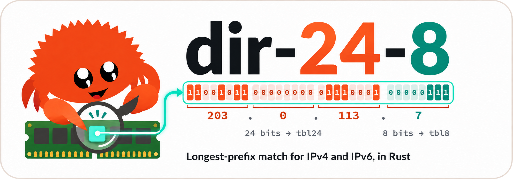
</p>

<p align="center">
  <a href="https://crates.io/crates/dir-24-8"></a>
  <a href="https://docs.rs/dir-24-8"></a>
  <a href="#license"></a>
  <a href="Cargo.toml"></a>
</p>

<p align="center">
  <a href="#testing-and-coverage"></a>
  <a href="#testing-and-coverage"></a>
</p>

**Fast IPv4 and IPv6 CIDR lookups in Rust**, zero-copy, with optional
**AVX-512 / AVX2 / NEON** batch lookups.

- **IPv4**: a true DIR-24-8, one or two memory reads per lookup.
- **IPv6**: a 24/8 multi-level trie, one read per level (at most 14).
- **Zero-copy**: lookups borrow the stored payload; no allocation, no clone, no lock.
- **SIMD batches**: AVX-512, AVX2 or NEON, detected at runtime (feature `batch-simd`).
- **Safe updates**: insert, merge and remove in place; a failed mutation changes nothing.

>The DIR-24-8 algorithm is a high-speed IP routing lookup algorithm used for Longest Prefix Matching (LPM), introduced by Pankaj Gupta et al. in 1998. It trades off memory usage to achieve fast packet forwarding, often performing a lookup in a single memory access.

## Contents

- [Installation](#installation)
- [Cargo features](#cargo-features)
- [Usage](#usage)
- [API overview](#api-overview)
- [How it works](#how-it-works)
- [Performance](#performance)
- [Platform support](#platform-support)
- [Minimum supported Rust version](#minimum-supported-rust-version)
- [Documentation and examples](#documentation-and-examples)
- [Development](#development)
- [Contributing](#contributing)
- [License](#license)

## Installation

```toml
[dependencies]
dir-24-8 = "0.1"

# With SIMD batch lookups:
# dir-24-8 = { version = "0.1", features = ["batch-simd"] }
```

- The crate is imported as `dir_24_8`.
- The default build has no feature: scalar kernels, and no dependency besides
  `ipnet` (and `libc` on Linux).

## Cargo features

| Feature | Default | Enables |
|:---|:---:|:---|
| `batch-simd` | no | AVX-512 / AVX2 (x86-64) and NEON (AArch64) batch kernels, selected at runtime; single lookups stay scalar |
| `derive` | no | `#[derive(DeepMerge)]` (crate `dir-24-8-derive`, re-exported as `dir_24_8::DeepMerge`) |
| `serde` | no | the `SerdeMerge` insert mode and `DeepMerge for serde_json::Value` |
| `snapshot` | no | compressed snapshots (`snapshot`, `load`, ...), through `serde`, `ciborium` and `liblzma` (C, system or vendored) |

## Usage

### Longest-prefix lookups

```rust
use std::net::IpAddr;
use dir_24_8::{IpNet, IpTable, Replace};

let mut table: IpTable<&str> = IpTable::new();
table.insert("10.0.0.0/8".parse::<IpNet>().unwrap(), Some("corp"), Replace).unwrap();
table.insert("10.1.0.0/16".parse::<IpNet>().unwrap(), None, Replace).unwrap(); // no payload
table.insert("2001:db8::/32".parse::<IpNet>().unwrap(), Some("doc"), Replace).unwrap();

let ip: IpAddr = "10.2.3.4".parse().unwrap();
let m = table.lookup(ip).unwrap();                 // Option<LookupMatch<'_, &str>>
assert_eq!(m.prefix.to_string(), "10.0.0.0/8");
assert_eq!(m.data, Some(&"corp"));                 // borrowed, never cloned

// A more specific route without payload wins the LPM.
let m = table.lookup("10.1.9.9".parse().unwrap()).unwrap();
assert_eq!((m.prefix.to_string().as_str(), m.data), ("10.1.0.0/16", None));

// `exist`: is any route (with or without payload) covering the address?
assert!(table.exist("10.1.9.9".parse().unwrap()));
assert!(!table.exist("192.0.2.1".parse().unwrap()));

// Batches write into a caller buffer, in input order.
let keys: Vec<IpAddr> = vec!["10.9.9.9".parse().unwrap(), "2001:db8::1".parse().unwrap()];
let mut out = vec![None; keys.len()];
table.lookup_batch_into(&keys, &mut out).unwrap();
assert_eq!(out[1].unwrap().data, Some(&"doc"));
```

Result of `lookup`:

- `None`: no route covers the address.
- `Some(LookupMatch { data: None, .. })`: the winning route has no payload.
- `Some(LookupMatch { data: Some(&t), .. })`: the payload of the winning route.

Related methods:

- `lookup_data` returns the payload alone; it never falls back to a less specific route.
- `exist` is `true` as soon as a route covers the address, payload or not.
- `contains_prefix` tests an exact CIDR, not an LPM.

Keys:

- IPv4 and IPv6 are separate key spaces: `192.0.2.1` and `::ffff:192.0.2.1` differ.
- Numeric keys: `u32::from(Ipv4Addr)` and `u128::from(Ipv6Addr)`; `[u8; N]` keys
  are network-order octets.

### Batch lookups

Batches run the SIMD kernel with `batch-simd`, the scalar two-phase kernel
otherwise; every kernel returns the same results.

```rust
use std::net::{IpAddr, Ipv4Addr};
use dir_24_8::{IpNet, IpTable, MatchId, Replace};

let mut table: IpTable<u32> = IpTable::new();
table.insert("10.0.0.0/8".parse::<IpNet>().unwrap(), Some(8), Replace).unwrap();
table.insert("2001:db8::/32".parse::<IpNet>().unwrap(), Some(32), Replace).unwrap();

// Mixed families, results in input order, into a caller buffer (no allocation).
let keys: Vec<IpAddr> = vec![
    "10.1.2.3".parse().unwrap(),
    "192.0.2.1".parse().unwrap(),
    "2001:db8::1".parse().unwrap(),
];
let mut out = vec![None; keys.len()];
table.lookup_batch_into(&keys, &mut out).unwrap();
let data: Vec<Option<u32>> = out.iter().map(|m| m.and_then(|m| m.data).copied()).collect();
assert_eq!(data, [Some(8), None, Some(32)]);

// Fixed-size arrays are returned by value; numeric keys skip the conversion.
let [a, b] = table.lookup_array(&[0x0A00_0001u32, 0xC000_0201]);
assert_eq!((a.and_then(|m| m.data), b.is_none()), (Some(&8), true));
let covered = table.exist_array(&[Ipv4Addr::new(10, 9, 9, 9), Ipv4Addr::new(192, 0, 2, 1)]);
assert_eq!(covered, [true, false]);

// Compact 4-byte identifiers, resolved on demand.
let mut ids = [MatchId::NONE; 2];
table.lookup_ids_into(&[0x0A00_0001u32, 0xC000_0201], &mut ids).unwrap();
assert_eq!(table.resolve(ids[0]).unwrap().data, Some(&8));
assert!(!ids[1].is_match());

// "scalar", or with `batch-simd` the CPU's kernel ("avx512", "avx2", "neon").
println!("batch kernel: {}", table.stats().batch_kernel);
```

Run `cargo run --release --example batch_kernel --features batch-simd` to see
the kernel your CPU gets.

### Insert modes and deep merge

The third argument of `insert`, `insert_addr` and `try_extend` decides what
happens when the CIDR is already present:

| Mode | CIDR present | Requires | Returns |
|---|---|---|---|
| `Replace` | payload replaced, including by `None` | nothing | previous payload, `None` for a new CIDR |
| `Merge` | payload deep merged | `T: DeepMerge` | `MergeOutcome` |
| `MergeWith(f)` | `f(&mut existing, incoming)` | `f: FnOnce(&mut T, T)` | `MergeOutcome` |
| `SerdeMerge` | merged through `serde_json::Value` | feature `serde` | `MergeOutcome` |

- The modes are zero-sized types: the choice costs nothing at run time.
- `Replace` works for any `T`; only the merging modes need `T: DeepMerge`.

```rust
use dir_24_8::{DeepMerge, IpNet, IpTable, Merge};

#[derive(DeepMerge)] // feature `derive`: no hand-written impl
struct Info {
    tags: Vec<String>, // concatenated
    asn: u32,          // incoming value wins
    #[deep_merge(skip)]
    first_seen: u64,   // existing value kept
}

let net: IpNet = "192.0.2.0/24".parse().unwrap();
let mut table = IpTable::new();
table.insert(net, Some(Info { tags: vec!["a".into()], asn: 1, first_seen: 10 }), Merge).unwrap();
table.insert(net, Some(Info { tags: vec!["b".into()], asn: 2, first_seen: 20 }), Merge).unwrap();
let info = table.lookup_data("192.0.2.1".parse().unwrap()).unwrap();
assert_eq!((info.tags.len(), info.asn, info.first_seen), (2, 2, 10));
```

- `#[derive(DeepMerge)]` merges structs field by field, and enums field by field
  when both values are the same variant.
- `#[deep_merge(replace)]` and `#[deep_merge(skip)]` change the rule of one field.

<details>
<summary>Merge rules</summary>

| Existing route | Incoming | Result | `MergeOutcome` |
|---|---|---|---|
| absent | `None` / `Some` | new route | `Inserted` |
| any | `None` | existing payload kept | `Unchanged` |
| `None` | `Some(v)` | `v` adopted | `Adopted` |
| `Some(cur)` | `Some(v)` | `cur.deep_merge(v)` | `Merged` |

- A merge targets exactly one normalized CIDR of one family; nested CIDRs are
  never touched.
- Provided impls: maps merge per key, `Vec` and `VecDeque` concatenate, `Option`
  keeps on `None`, scalars and strings are replaced.
- Serde adapter (`serde`): objects merge per key, absent keys are kept, arrays
  concatenate, scalars and an explicit `null` replace.
- If a serde merge no longer deserializes into `T`, the payload is kept and
  `Error::MergeFailed` is returned.

</details>

### Updates and removal

```rust
use dir_24_8::{IpNet, IpTable, Replace};

let wide: IpNet = "10.0.0.0/8".parse().unwrap();
let narrow: IpNet = "10.1.0.0/16".parse().unwrap();
let mut table = IpTable::new();
table.insert(wide, Some("wide"), Replace).unwrap();
assert_eq!(table.insert(narrow, Some("narrow"), Replace).unwrap(), None); // a new CIDR
assert_eq!(table.lookup_data("10.1.2.3".parse().unwrap()), Some(&"narrow"));

// Replace the payload of an existing CIDR only (never inserts).
assert_eq!(table.replace(narrow, Some("lab")), Some(Some("narrow")));

// Removing a route restores the best remaining less specific one.
assert_eq!(table.remove(narrow), Some(Some("lab")));
assert_eq!(table.lookup_data("10.1.2.3".parse().unwrap()), Some(&"wide"));
assert_eq!(table.get(wide), Some(Some(&"wide")));
assert!(!table.contains_prefix(narrow));
```

- Every mutation keeps the table invariants: each cell holds its longest route,
  uniform groups are folded and reused.
- A failed mutation leaves the table unchanged; `examples/update_remove.rs` shows
  group reuse.

### Compressed snapshots

With the `snapshot` feature (runnable version: `examples/snapshot.rs`):

```rust
use dir_24_8::{IpNet, IpTable, LoadOptions, Replace, SnapshotOptions};

let mut table = IpTable::new();
table.insert("10.0.0.0/8".parse::<IpNet>().unwrap(), Some(String::from("corp")), Replace).unwrap();
table.insert("10.1.0.0/16".parse::<IpNet>().unwrap(), None, Replace).unwrap(); // no payload

let bytes: Vec<u8> = table.snapshot().unwrap(); // XZ 9 + extreme, CRC64
let restored: IpTable<String> = IpTable::load(&bytes).unwrap(); // borrows `bytes`
assert_eq!(restored.get("10.1.0.0/16".parse::<IpNet>().unwrap()), Some(None));

let path = std::env::temp_dir().join(format!("readme-{}.snap", std::process::id()));
table.snapshot_to_file(&path).unwrap(); // temporary file, then atomic rename
let restored: IpTable<String> = IpTable::load_from_file(&path).unwrap();
assert_eq!(restored.len(), 2);
std::fs::remove_file(&path).unwrap();

// Faster compression, and limits for untrusted input:
let fast = table.snapshot_with_options(&SnapshotOptions::new().level(6).extreme(false)).unwrap();
let limits = LoadOptions::new().max_entries(1_000_000).max_value_bytes(4096);
let _: IpTable<String> = IpTable::load_with_options(&fast, &limits).unwrap();
```

- **State**: every route of both families, payloads, routes without payload and
  the `Config`.
- **Load**: lookup tables and indexes are rebuilt; the batch kernel is detected
  again for the loading CPU.
- **Format**: 16-byte header, then one XZ stream (CRC64) with a columnar body and
  CBOR payloads; the specification is in the `snapshot` module docs.
- **Streaming**: save and load go route by route; neither builds the whole
  uncompressed snapshot.
- **Bounds**: `T: Serialize` to save, `T: DeserializeOwned` to load, no `Clone`.
- **Options**: XZ level, dictionary, threads, encoder memory budget, entry order,
  file sync (`SnapshotOptions`).
- **Limits**: decoder memory, decompressed bytes, entries, bytes per payload
  (`LoadOptions`).
- **Errors**: `SnapshotError`; a failed load returns no table, a failed file
  snapshot keeps the previous file.

## API overview

Every lookup takes `&self` and never allocates, clones `T` or locks. 🔍 ✅
single lookups always run the scalar kernels; ⚡ 🏷️ batches run the batch
kernel (the CPU's SIMD kernel with `batch-simd`, scalar otherwise).

| | Operation | Methods | Returns |
|:---:|---|---|---|
| 🏗️ | **Construct** | `IpTable::new()`, `IpTable::with_config(Config)`, `config()` | `IpTable<T>`, `Result<IpTable<T>, Error>`, `&Config` |
| ➕ | **Insert** a CIDR or a host | `insert(net, Option<T>, mode)`, `insert_addr(ip, Option<T>, mode)`, `try_extend(iter, mode)` | `Result<M::Output, Error>`, `Result<(), Error>` |
| 🔀 | **Insert modes** | `Replace`, `Merge` (`T: DeepMerge`), `MergeWith(f)`, `SerdeMerge` (feature `serde`) | `Replace`: previous payload `Option<Option<T>>`; merges: `MergeOutcome` |
| ✏️ | **Replace** a payload (never inserts) | `replace(net, Option<T>)` | `Option<Option<T>>` |
| ➖ | **Remove** (restores the parent route) | `remove(net)`, `clear()` | `Option<Option<T>>` |
| 🎯 | **Exact CIDR** (not an LPM) | `get(net)`, `get_mut(net)`, `contains_prefix(net)` | `Option<Option<&T>>`, `Option<&mut Option<T>>`, `bool` |
| 🔍 | **Longest-prefix match** | `lookup(IpAddr)`, `lookup_ipv4(Ipv4Addr)`, `lookup_ipv6(Ipv6Addr)`, `lookup_data(IpAddr)` | `Option<LookupMatch<'_, T>>`, `Option<&T>` |
| ✅ | **Membership** | `exist(IpAddr)`, `exist_ipv4(Ipv4Addr)`, `exist_ipv6(Ipv6Addr)` | `bool` |
| ⚡ | **Batches** into caller buffers | `lookup_batch_into(&[K], &mut [Option<LookupMatch>])`, `exist_batch_into(&[K], &mut [bool])` | `Result<(), Error>` |
| ⚡ | **Batches** of fixed-size arrays | `lookup_array(&[K; N])`, `exist_array(&[K; N])` | `[Option<LookupMatch<'_, T>>; N]`, `[bool; N]` |
| 🏷️ | **Identifiers** (4 bytes, resolved on demand) | `lookup_ids_into(&[K], &mut [MatchId])`, `resolve(MatchId)` | `Result<(), Error>`, `Option<LookupMatch<'_, T>>` |
| 📊 | **Introspection** | `len()`, `is_empty()`, `len_ipv4()`, `len_ipv6()`, `iter()`, `iter_mut()`, `stats()` | `usize`, `bool`, `(IpNet, Option<&T>)` items, `TableStats` (`batch_kernel` names the batch kernel) |
| 💾 | **Snapshots** (feature `snapshot`) | `snapshot()`, `snapshot_to_file(path)`, `snapshot_to_writer(w, &opts)`, `load(bytes)`, `load_from_file(path)`, `load_from_reader(r, &opts)`, `_with_options` variants | `Result<Vec<u8>, SnapshotError>` (save), `Result<IpTable<T>, SnapshotError>` (load) |

Batch key types (`BatchKey`, the `K` above):

| | Keys | Family | Notes |
|:---:|---|---|---|
| 🌐 | `IpAddr` | IPv4 + IPv6 | mixed batches, split per family in chunks of 256 |
| 4️⃣ | `Ipv4Addr`, `u32`, `[u8; 4]` | IPv4 | `u32` (= `u32::from(Ipv4Addr)`) goes to the kernel without conversion; `[u8; 4]` are network-order octets |
| 6️⃣ | `Ipv6Addr`, `u128`, `[u8; 16]` | IPv6 | `[u8; 16]` (network-order octets) goes to the kernel without conversion; `u128` = `u128::from(Ipv6Addr)` |

⚠️ Output buffers must have exactly the input length: it is checked before
any write (`Error::LengthMismatch`), and result `i` belongs to key `i`.

## How it works

### Data structure

- **Cells**: a `u32` cell is `0` (no route), a route slot, or a secondary group
  (`0x8000_0000 | g`); the sign bit is the group flag.
- **Longest route per cell**: a lookup never backtracks: one read of `tbl24`,
  then at most one group per level.
- **Folding**: a group whose 256 cells become identical is folded into its
  parent cell and released.
- **Shared payloads**: all cells of a route store the same slot, so every match
  borrows the same `T`.

> ⚠️ **This structure needs a lot of RAM.**
>
> - Each family maps a **64 MiB** root on its first insertion, even for one route.
> - IPv6 routes longer than /24 need one 1 KiB group per level.
> - About **160 B per IPv4 prefix** and **1.7 KiB per IPv6 prefix** at 1M
>   prefixes; compact tries need 22-115 B.
> - **842 MiB** for 5M IPv4 prefixes, **8.54 GiB** for 5M IPv6 prefixes.
> - Check the [memory costs](#memory) and cap tables with `Config::max_routes` /
>   `max_ipv6_groups`.

<p align="center">
  <a href="https://0x00f6.github.io/dir-24-8/assets/dir_24_8_lookup_cpu.mp4">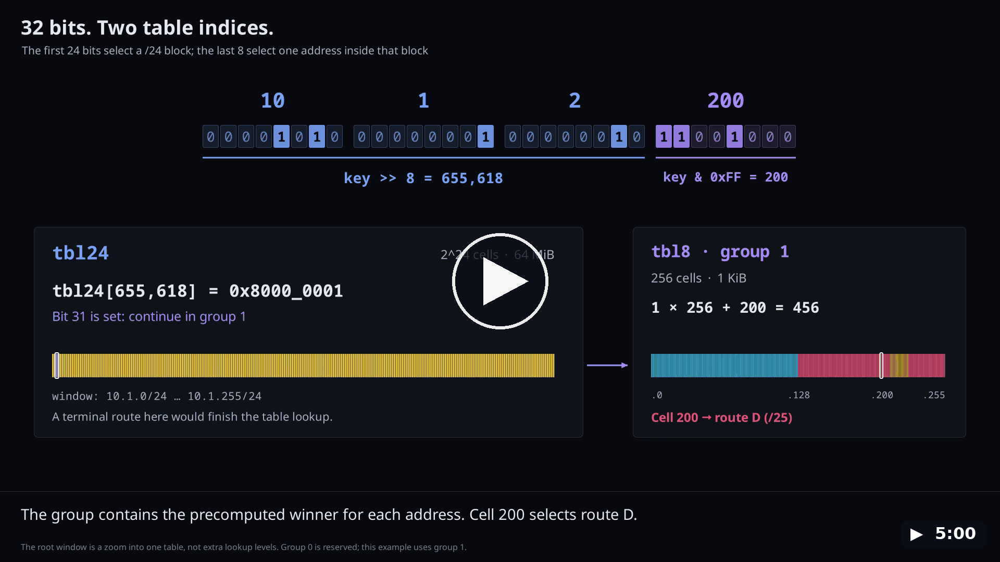</a>
  <br>
  <em>▶ Video (5 min): how an IPv4 lookup works, down to the CPU caches — the two table reads of <code>10.1.2.200</code> (<code>tbl24</code>, then a <code>tbl8</code> group), then what the core, its registers, the L1/L2/L3 caches and RAM do for each read, and how batches overlap the waits.</em>
  <br>
  <a href="https://0x00f6.github.io/dir-24-8/assets/dir_24_8_lookup_cpu.mp4">▶ Watch in the browser</a> · <a href="https://github.com/0x00F6/dir-24-8/raw/master/docs/videos/dir_24_8_lookup_cpu.mp4">⬇ Download (MP4, 21 MB)</a>
</p>

### Zero-copy and allocations

- **No allocation in lookups**: verified by `tests/no_alloc.rs` with a counting
  allocator; only small `Copy` values are copied.
- **Bounded stack buffers**: batches go through chunks of 64 keys (256 for mixed
  families).
- **Moves, not clones**: insertions move `T` into its slot; merges consume the
  incoming value.
- **Allocations only in mutations**: the 64 MiB root on first use, slot and index
  growth, new 1 KiB groups.

### Batches and SIMD

| Kernel | Build | CPU | Batch technique |
|---|---|---|---|
| `scalar` | always | any | two-phase blocks (independent root loads, then branch-free secondary steps); every single lookup (textbook walk) |
| `avx512` | `batch-simd` | x86-64 (F+BW+VL) | 16 lanes; IPv4 `vpgatherdd` roots then masked gathers; IPv6 4 vectors (64 lanes) transposed with `vpunpck*`, lock-step masked gathers |
| `avx2` | `batch-simd` | x86-64 | 8 lanes; same structure with vector-mask gathers (the cell sign bit is the mask); IPv6 4 vectors (32 lanes) |
| `neon` | `batch-simd` | AArch64 | 4 lanes of index math (`vshrq_n_u32`, `vorrq_u32`, `vminq_u32`, `vcltzq_s32`, `vld4q_u32` transpose), one scalar load per active lane (NEON has no memory gather) |

- **Scalar single lookups**: one lookup is a dependent chain; the scalar walk
  was the fastest (a one-lane gather took 1.5x its time).
- **Detection once per table**: AVX-512, then AVX2, then NEON, else scalar;
  `table.stats().batch_kernel` names it.
- **Memory-level parallelism**: root reads of a whole block first, slot
  prefetch one chunk ahead, IPv6 lanes in lock step.
- **Measured gains** (AVX-512): IPv4 batch 15.6 → 8.05 ns per address, mixed
  batch 46.5 → 38.4 ns.
- **AVX-512 before AVX2**: faster or equal on Zen 4; on Intel with the
  Downfall/GDS microcode, check `make bench-compare`.

### Memory

| Item | Cost |
|---|---|
| root per family | 2^24 cells x 4 B = **64 MiB**, mapped on the first insert of that family, lazily zeroed |
| secondary group | 256 x 4 B = 1 KiB |
| route slot | prefix + `Option<T>` (16 B for IPv4 / `u32`, 28 B for IPv6) |
| prefix index | one `HashMap` entry per route (maintenance only) |

Measured footprints (`make bench BENCHES=update`, BGP-like mixes):

| Family | Routes | Groups | tbl8 | Total |
|---|---|---|---|---|
| IPv4 | 200 000 | 10 515 | 16 MiB | 88 MiB |
| IPv6 | 100 000 | 181 029 | 272 MiB | 344 MiB |

- **mmap**: on Linux, roots and large group buffers are mapped outside the
  allocator and zeroed lazily.
- **Statistics**: `stats()` reports routes, groups and bytes per component.
- **Limits**: `max_ipv4_groups`, `max_ipv6_groups` (2^23 - 1) and `max_routes`
  (2^31 - 1) return `Error::CapacityExceeded`.
- **Huge pages**: opt-in with `Config::huge_pages(true)`; off by default because
  it slowed construction 15-25x on fragmented memory.

### Safety

- **Clamped gathers**: every secondary gather index is clamped to the last valid
  `tbl8` cell.
- **24-bit root indices**: `tbl24` has exactly 2^24 cells; scalar kernels
  bounds-check every `tbl8` read.
- **Confined `unsafe`**: each block has a `// SAFETY:` comment; SIMD variants
  exist only after runtime detection (see [AGENTS.md](AGENTS.md)).

## Performance

- Benchmarks compare `dir-24-8` with LPM and membership structures in Rust, Go
  and C.
- Every suite uses the same generated BGP-like tables and query distributions.
- Every structure is validated against an oracle before anything is timed.
- **Full interactive reports of the latest release**:
  - 🌟 [`make bench-compare` report](https://0x00f6.github.io/dir-24-8/bench-compare/report.html) and
  - 🌟[`make bench-compare-lib` report](https://0x00f6.github.io/dir-24-8/bench-compare-lib/bench-compare-lib.html).

### Running the benchmarks

```bash
make bench               # Criterion: single, batch and exist lookups + updates (SIMD batches)
make bench SIMD=0        # the same, built without batch-simd (scalar batches)
make bench BENCHES=snapshot   # snapshot size, save and load time, memory
make bench-compare       # Rust LPM/membership structures, 1k-5M entries, 1/4/8 threads -> benchmarks/reports/report.html
                         # and the detailed results below (README=auto|1|0)
make bench-compare-lib   # Go, C and Rust libraries, each in a native runner -> benchmarks/reports/bench-compare-lib.html
                         # and the summary table below (BENCH_README=auto|1|0)
```

- `make bench-compare` measures `dir-24-8` (with `batch-simd`) and
  `dir-24-8[scalar]` (without it).
- It also draws batch throughput against batch size (`BATCH_SWEEP`, 1 to 1024).
- Both suites write a standalone HTML report with JSON and CSV results.
- Methodology: [benchmarks/README.md](benchmarks/README.md) and
  [benchmarks/compare-lib/README.md](benchmarks/compare-lib/README.md).

<details>
<summary>📊 Full HTML report preview (static image)</summary>


</details>

### Evaluated libraries

| Library Name | Language | Role | Evaluated Version | Compiler & Build Flags | Upstream Repository |
|:---|:---:|:---:|:---:|:---|:---|
| 🦀 **`dir-24-8`** | Rust | LPM + membership (reference) | workspace | `rustc 1.98.1` (release, `codegen-units = 1`, thin LTO, no `target-cpu`) | this repository |
| 🦀 **`prefix-trie`** | Rust | LPM (Tree Bitmap style) | 0.10 | same Rust profile | [tiborschneider/prefix-trie](https://github.com/tiborschneider/prefix-trie) |
| 🦀 **`ip_network_table`** | Rust | LPM (Tree Bitmap) | 0.2 | same Rust profile | [crates.io/crates/ip_network_table](https://crates.io/crates/ip_network_table) |
| 🦀 **`iptrie`** | Rust | LPM (LC-trie, radix) | 0.11 | same Rust profile | [crates.io/crates/iptrie](https://crates.io/crates/iptrie) |
| 🦀 **`rangemap`**, **`radix_trie`**, **`patricia_tree`** | Rust | LPM (ranges, generic tries) | 1.8, 0.3, 0.10 | same Rust profile | crates.io |
| 🦀 **`roaring`** | Rust | membership only (IPv4) | 0.12 | same Rust profile | crates.io |
| 🦀 Poptrie, sorted intervals, hash per length, PATRICIA | Rust | LPM (own implementations of the papers) | - | same Rust profile | [`benchmarks/compare`](benchmarks/compare) |
| 🐹 **`bart`** | Go | LPM + membership | v0.30.0 | `go1.27.3`, `CGO_ENABLED=0`, `-trimpath`, `GOAMD64=v1` | [gaissmai/bart](https://github.com/gaissmai/bart) |
| 🐹 **`go-iptrie`** | Go | LPM + membership | v0.0.0-20240326174613-ba542f5282c9 | same Go flags | [phemmer/go-iptrie](https://github.com/phemmer/go-iptrie) |
| 🐹 **`go-cidranger`** (libp2p) | Go | membership, adapted LPM | v1.1.0 | same Go flags | [libp2p/go-cidranger](https://github.com/libp2p/go-cidranger) |
| 🐹 **`cidranger`** (yl2chen) | Go | membership, adapted LPM | v1.0.2 | same Go flags | [yl2chen/cidranger](https://github.com/yl2chen/cidranger) |
| 🏛️ **`libmaxminddb`** | C | LPM over an MMDB file | 1.14.1 (SHA-256 pinned) | `gcc 15.2`, `-O2 -pthread` | [maxmind/libmaxminddb](https://github.com/maxmind/libmaxminddb) |

- **Toolchains**: Rust 1.98.1, Go 1.27.3, gcc 15.2.
- **Noise**: the laptop was in use; one configuration can vary by 2x between
  processes.

### Summary: throughput and p99 latency

<!-- bench-compare-lib:summary:start -->
- **Run**: `make bench-compare-lib`, standard profile, 2026-11-07, AMD EPYC 9V45 96-Core Processor
- **Workload**: 1M input prefixes, mixed scenario (50 % hits), one thread unless noted
- **Statistic**: median of 5 processes per library
- **Full report**: [bench-compare-lib.html](https://0x00f6.github.io/dir-24-8/bench-compare-lib/bench-compare-lib.html) (every size and scenario; `benchmarks/reports/` locally), methodology in [benchmarks/compare-lib/README.md](benchmarks/compare-lib/README.md)

<!-- Generated by `make bench-compare-lib` (BENCH_README): do not edit by hand. -->

| Scenario | Metric | 🦀 `dir-24-8 (scalar)` | 🐹 `go-cidranger-libp2p` | 🐹 `cidranger-yl2chen` | 🐹 `go-iptrie` | 🐹 `bart` | 🦀 `prefix-trie` | 🦀 `iprange` | 🏛️ `libmaxminddb` |
|:---|:---:|:---:|:---:|:---:|:---:|:---:|:---:|:---:|:---:|
| IPv4 LPM lookup | Throughput | 🏆 **62.2 M/s** | 1.0 M/s (adapted) | 0.6 M/s (adapted) | 1.4 M/s | 13.0 M/s | 26.0 M/s | — | 5.2 M/s |
| IPv4 LPM lookup, 4 threads | Throughput | 🏆 **168.3 M/s** | 3.5 M/s | 2.2 M/s | 5.5 M/s | 48.5 M/s | 84.3 M/s | — | 21.7 M/s |
| IPv4 LPM lookup | p99 Tail Latency | 291 ns | 2 684 ns | 4 347 ns | 1 983 ns | 581 ns | 🏆 **170 ns** | — | 661 ns |
| IPv4 membership | Throughput | 🏆 **168.7 M/s** | 12.2 M/s | 10.5 M/s | 17.3 M/s | 90.1 M/s | 35.5 M/s | 61.5 M/s | 5.8 M/s |
| IPv4 structure | Bytes per prefix | 160 B | 274 B | 756 B | 150 B | 40 B | 22 B | 🏆 **14 B** | 28 B |
| IPv6 LPM lookup | Throughput | 🏆 **10.2 M/s** | 0.9 M/s (adapted) | 0.5 M/s (adapted) | 1.2 M/s | 4.9 M/s | 5.4 M/s | — | 2.5 M/s |
| IPv6 LPM lookup, 4 threads | Throughput | 🏆 **24.6 M/s** | 3.0 M/s | 1.9 M/s | 4.5 M/s | 16.0 M/s | 22.1 M/s | — | 8.4 M/s |
| IPv6 LPM lookup | p99 Tail Latency | 922 ns | 2 934 ns | 5 599 ns | 2 253 ns | 932 ns | 🏆 **421 ns** | — | 1 141 ns |
| IPv6 membership | Throughput | 16.1 M/s | 3.4 M/s | 2.1 M/s | 5.4 M/s | 🏆 **24.4 M/s** | 6.4 M/s | 9.1 M/s | 2.8 M/s |
| IPv6 structure | Bytes per prefix | 1 734 B | 335 B | 816 B | 160 B | 111 B | 🏆 **57 B** | 81 B | 115 B |
<!-- bench-compare-lib:summary:end -->

- The two cidrangers have no LPM API: their lookup is adapted from
  `ContainingNetworks`, allocation included.
- dir-24-8 trades memory for speed: 64 MiB roots and IPv6 groups.

### Charts

- Full interactive reports: [`make bench-compare`](https://0x00f6.github.io/dir-24-8/bench-compare/report.html) and
  [`make bench-compare-lib`](https://0x00f6.github.io/dir-24-8/bench-compare-lib/bench-compare-lib.html).
- Captured from the HTML reports of the runs above (`site/charts.sh`).
- The charts, the summary and the detailed results are refreshed for every
  release by [`.github/workflows/pages.yml`](.github/workflows/pages.yml),
  which commits them to `master`.
- `make bench-compare` charts: 1M entries unless noted, random distribution (50 %
  hits), one thread.

<!-- benchmark-charts:start -->
<p align="center"><strong>Candlestick Percentile Rank — IPv4 Lookups</strong><br>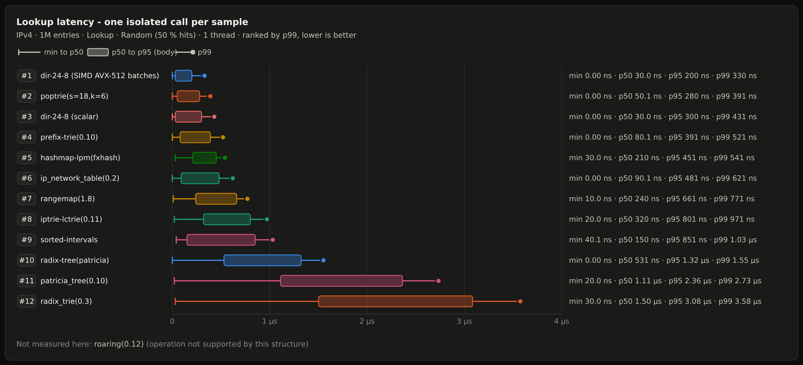</p>

<p align="center"><strong>Candlestick Percentile Rank — IPv6 Lookups</strong><br>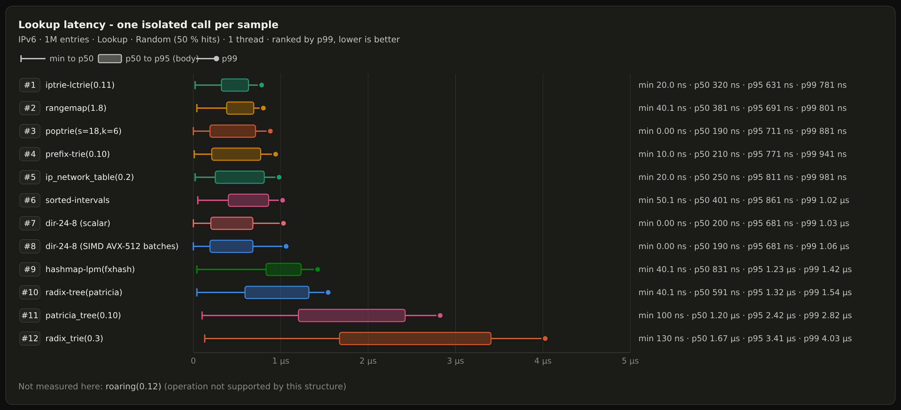</p>

<p align="center"><strong>IPv4 Batch Throughput</strong><br>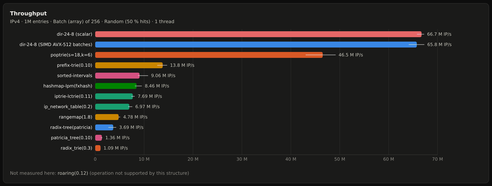</p>

<p align="center"><strong>IPv6 Batch Throughput</strong><br>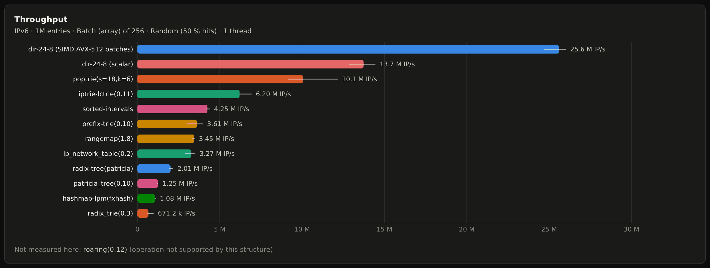</p>

<p align="center"><strong>IPv4 Batch Throughput vs Batch Size — SIMD vs Scalar</strong><br>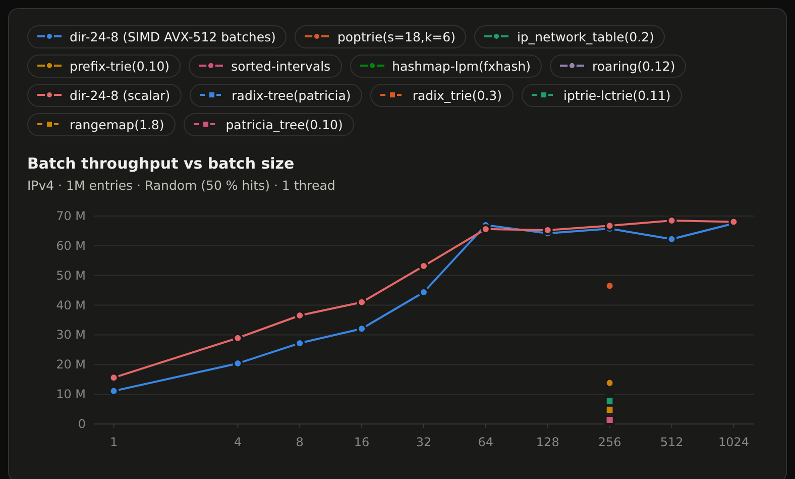</p>

<p align="center"><strong>IPv4 Batch Throughput vs Entries</strong><br>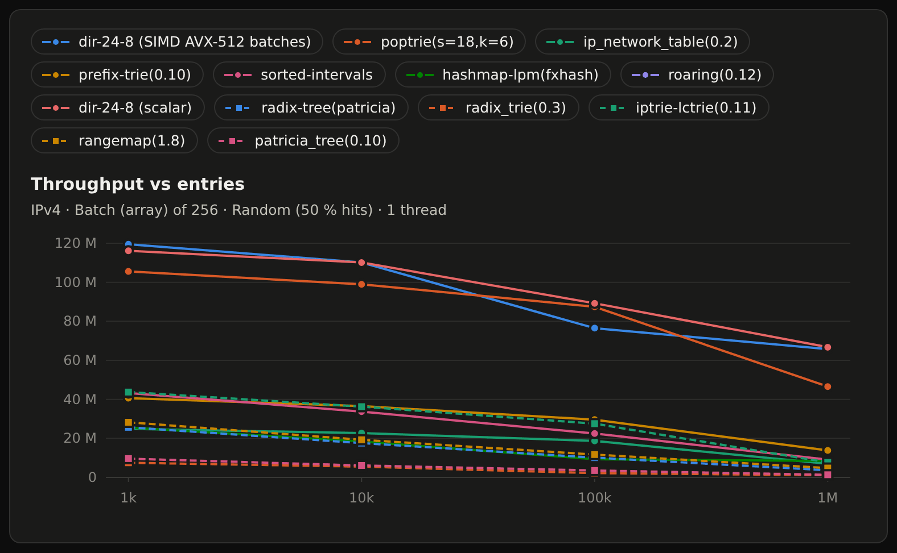</p>

<p align="center"><strong>IPv4 Batch Throughput vs Threads</strong><br>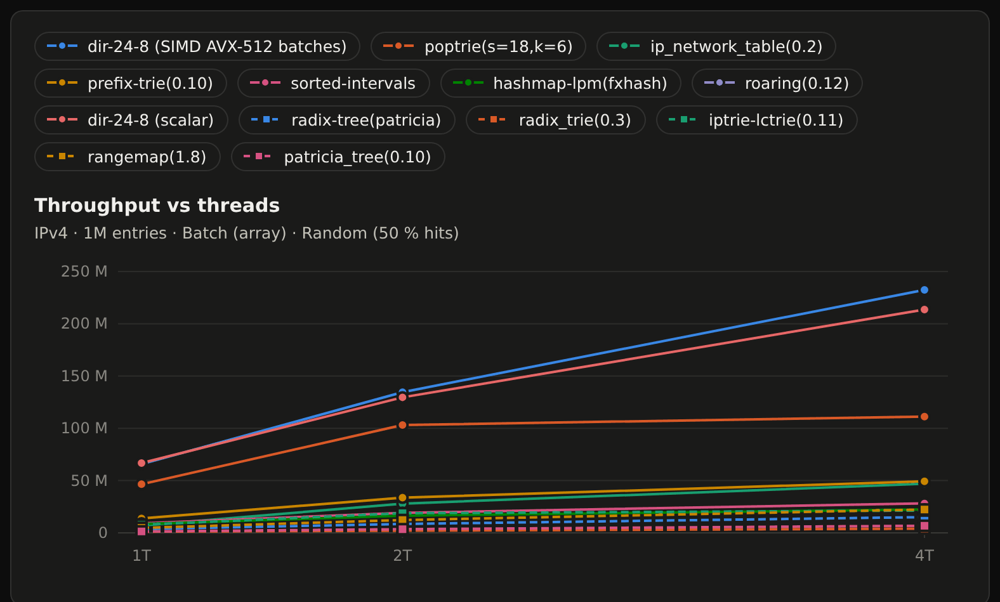</p>

<p align="center"><strong>IPv6 Memory Footprint vs Entries</strong><br>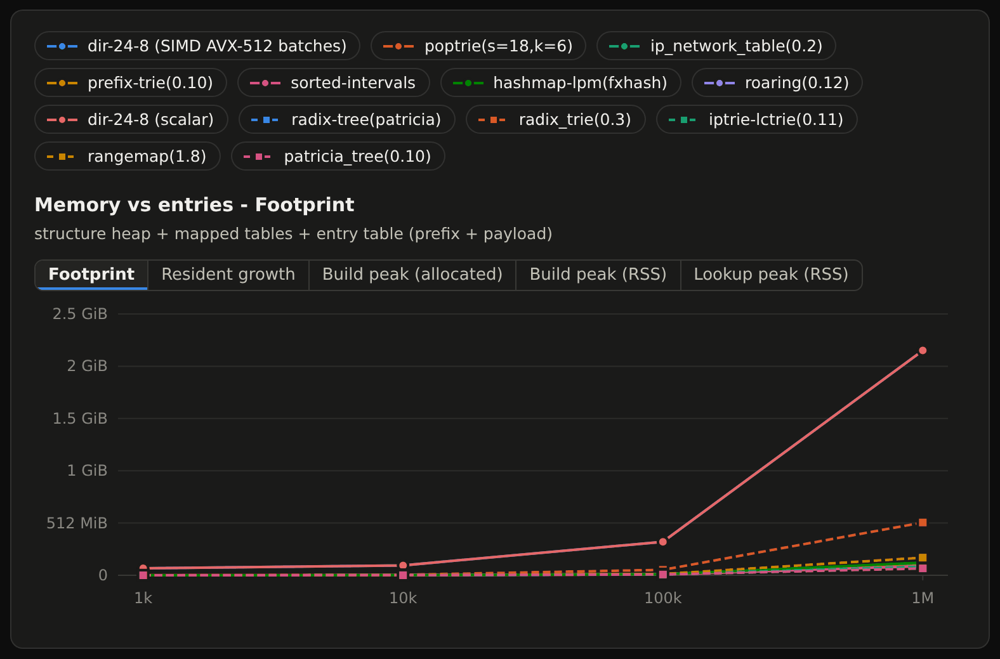</p>

<p align="center"><strong>Go, C and Rust Libraries — IPv4 LPM Lookup Throughput</strong><br>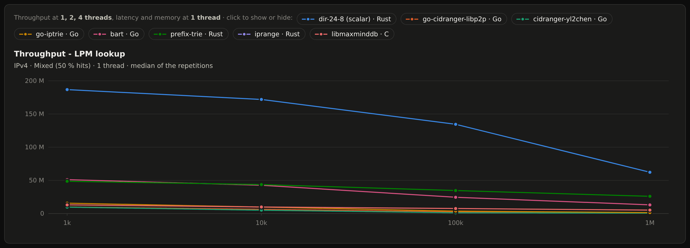</p>

<p align="center"><strong>Go, C and Rust Libraries — IPv6 LPM Lookup Throughput</strong><br>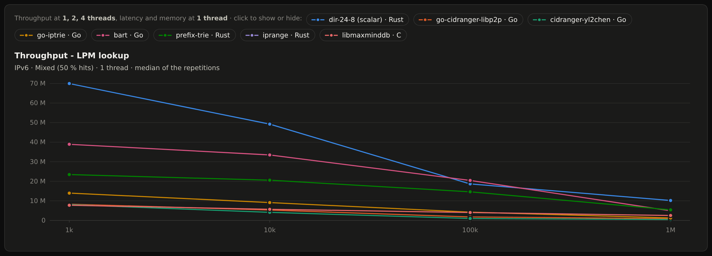</p>

<p align="center"><strong>Go, C and Rust Libraries — IPv4 LPM Latency</strong><br>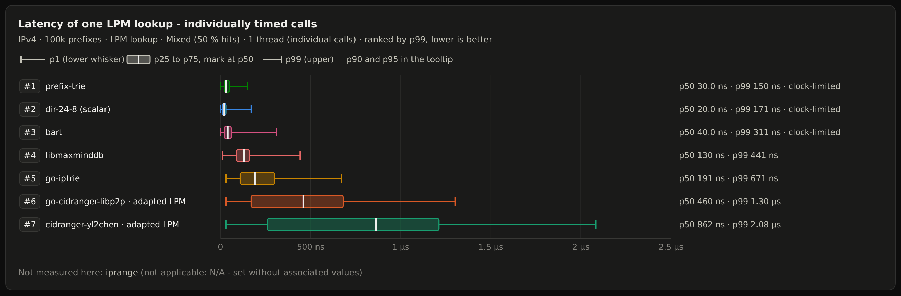</p>
<!-- benchmark-charts:end -->

### Detailed results

<!-- bench-compare:details:start -->
- **Run**: `make bench-compare`, 2026-11-07, AMD EPYC 9V45 96-Core Processor, dir-24-8 batch kernel avx512
- **Workload**: random distribution (50 % hits), 1 048 576 queries, batches of 256
- **Units**: M/s = millions of addresses per second (full `Option<LookupMatch>` results); p50/p99 of isolated single lookups, one thread
- **Footprint**: includes the prefix + payload table competitors need
- **Reading**: 🏆 marks the best value of each column; rows are sorted by single-thread batch throughput
- **Full report**: [report.html](https://0x00f6.github.io/dir-24-8/bench-compare/report.html) (every size, distribution and thread count; `benchmarks/reports/` locally)

<!-- Generated by `make bench-compare` (README): do not edit by hand. -->

| IPv4, 1M | lookup 1T | batch 1T | exists 1T | lookup 4T | batch 4T | p50 | p99 | footprint | build |
|---|---|---|---|---|---|---|---|---|---|
| `dir-24-8 (scalar)` | 48 M/s | 🏆 **67 M/s** | 🏆 **273 M/s** | 🏆 **155 M/s** | 214 M/s | 🏆 **30 ns** | 431 ns | 174 MiB | 0.46 s |
| `dir-24-8 (SIMD AVX-512 batches)` | 🏆 **60 M/s** | 66 M/s | 254 M/s | 145 M/s | 🏆 **232 M/s** | 🏆 **30 ns** | 🏆 **330 ns** | 174 MiB | 0.45 s |
| `poptrie(s=18,k=6)` | 32 M/s | 47 M/s | 114 M/s | 89 M/s | 111 M/s | 50 ns | 391 ns | 39 MiB | 0.42 s |
| `prefix-trie(0.10)` | 8.8 M/s | 14 M/s | 35 M/s | 33 M/s | 49 M/s | 80 ns | 521 ns | 51 MiB | 0.08 s |
| `sorted-intervals` | 4.0 M/s | 9.1 M/s | 16 M/s | 21 M/s | 28 M/s | 150 ns | 1.03 µs | 46 MiB | 0.09 s |
| `hashmap-lpm(fxhash)` | 6.8 M/s | 8.5 M/s | 11 M/s | 18 M/s | 22 M/s | 210 ns | 541 ns | 53 MiB | 🏆 **0.02 s** |
| `iptrie-lctrie(0.11)` | 6.4 M/s | 7.7 M/s | 11 M/s | 24 M/s | 21 M/s | 320 ns | 971 ns | 50 MiB | 0.49 s |
| `ip_network_table(0.2)` | 6.0 M/s | 7.0 M/s | 15 M/s | 32 M/s | 47 M/s | 90 ns | 621 ns | 46 MiB | 0.10 s |
| `rangemap(1.8)` | 4.2 M/s | 4.8 M/s | 6.5 M/s | 16 M/s | 22 M/s | 240 ns | 771 ns | 72 MiB | 0.67 s |
| `radix-tree(patricia)` | 2.8 M/s | 3.7 M/s | 3.6 M/s | 14 M/s | 15 M/s | 531 ns | 1.55 µs | 59 MiB | 0.33 s |
| `patricia_tree(0.10)` | 1.1 M/s | 1.4 M/s | 1.8 M/s | 4.9 M/s | 6.8 M/s | 1.11 µs | 2.73 µs | 56 MiB | 0.91 s |
| `radix_trie(0.3)` | 0.9 M/s | 1.1 M/s | 1.1 M/s | 4.1 M/s | 4.0 M/s | 1.50 µs | 3.58 µs | 479 MiB | 1.5 s |
| `roaring(0.12)` (exists only) | — | — | 24 M/s | — | — | — | — | 🏆 **3 MiB** | 0.29 s |

| IPv6, 1M | lookup 1T | batch 1T | exists 1T | lookup 4T | batch 4T | p50 | p99 | footprint | build |
|---|---|---|---|---|---|---|---|---|---|
| `dir-24-8 (SIMD AVX-512 batches)` | 🏆 **11 M/s** | 🏆 **26 M/s** | 15 M/s | 28 M/s | 🏆 **80 M/s** | 🏆 **190 ns** | 1.06 µs | 2.15 GiB | 3.0 s |
| `dir-24-8 (scalar)` | 11 M/s | 14 M/s | 🏆 **18 M/s** | 🏆 **29 M/s** | 43 M/s | 200 ns | 1.03 µs | 2.15 GiB | 2.9 s |
| `poptrie(s=18,k=6)` | 7.3 M/s | 10 M/s | 8.5 M/s | 20 M/s | 29 M/s | 🏆 **190 ns** | 881 ns | 90 MiB | 0.94 s |
| `iptrie-lctrie(0.11)` | 5.2 M/s | 6.2 M/s | 6.1 M/s | 15 M/s | 17 M/s | 320 ns | 🏆 **781 ns** | 85 MiB | 0.52 s |
| `sorted-intervals` | 3.7 M/s | 4.3 M/s | 4.9 M/s | 12 M/s | 13 M/s | 401 ns | 1.02 µs | 90 MiB | 0.21 s |
| `prefix-trie(0.10)` | 3.1 M/s | 3.6 M/s | 6.1 M/s | 13 M/s | 15 M/s | 210 ns | 941 ns | 95 MiB | 0.19 s |
| `rangemap(1.8)` | 3.1 M/s | 3.5 M/s | 3.5 M/s | 10 M/s | 12 M/s | 381 ns | 801 ns | 172 MiB | 0.92 s |
| `ip_network_table(0.2)` | 3.4 M/s | 3.3 M/s | 4.5 M/s | 12 M/s | 16 M/s | 250 ns | 981 ns | 105 MiB | 0.23 s |
| `radix-tree(patricia)` | 1.6 M/s | 2.0 M/s | 2.0 M/s | 7.9 M/s | 9.0 M/s | 591 ns | 1.54 µs | 82 MiB | 0.45 s |
| `patricia_tree(0.10)` | 0.9 M/s | 1.3 M/s | 1.4 M/s | 4.3 M/s | 4.9 M/s | 1.20 µs | 2.82 µs | 🏆 **67 MiB** | 1.00 s |
| `hashmap-lpm(fxhash)` | 1.2 M/s | 1.1 M/s | 1.4 M/s | 3.5 M/s | 3.5 M/s | 831 ns | 1.42 µs | 125 MiB | 🏆 **0.05 s** |
| `radix_trie(0.3)` | 0.8 M/s | 0.7 M/s | 1.0 M/s | 3.2 M/s | 3.4 M/s | 1.67 µs | 4.03 µs | 517 MiB | 1.6 s |
<!-- bench-compare:details:end -->

See [docs/performance.md](docs/performance.md) for every measurement behind the
design choices, kept and rejected.

### Flame graph

```bash
make flamegraph   # PROFILE_SECONDS=<s> per method, default 1
```

- Profiles every public lookup method, IPv4 and IPv6, about one second each.
- Workload: `examples/lookup_profile.rs` with `batch-simd`, 100k IPv4 + 50k IPv6
  routes, 50 % hits.
- `perf` with frame-pointer unwinding, built in its own target directory.
- Output: `target/flamegraph/lookup-flamegraph.svg`, copied to the image below.

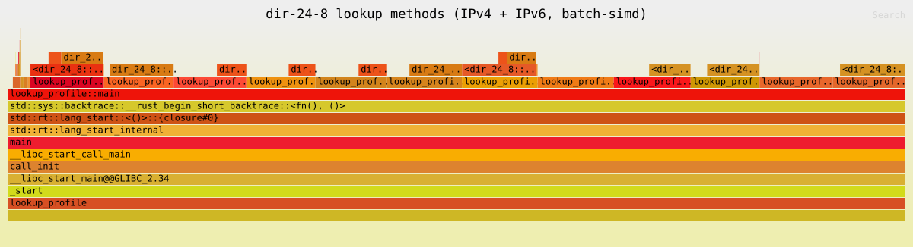

## Platform support

| Target | Single lookups | Batch lookups with `batch-simd` |
|---|---|---|
| x86-64 | scalar | AVX-512 (F, BW, VL) or AVX2, else scalar |
| AArch64 | scalar | NEON (compiled, linted and tested in CI; not measured) |
| other | scalar | scalar |

- Large tables are `mmap`ed on Linux and heap allocated elsewhere.
- SVE/SVE2 intrinsics are still unstable on stable Rust: NEON covers AArch64.

## Minimum supported Rust version

- Rust **1.89** or later, stable only (edition 2024).
- AVX-512 intrinsics and target features were stabilized in 1.89.

## Documentation and examples

- API documentation: [docs.rs/dir-24-8](https://docs.rs/dir-24-8).
- Project page with the latest benchmark reports and API docs:
  [0x00f6.github.io/dir-24-8](https://0x00f6.github.io/dir-24-8/), rebuilt by
  [`.github/workflows/pages.yml`](.github/workflows/pages.yml) for every version
  tag (`make release`).
- Design and measurements: [docs/architecture.md](docs/architecture.md),
  [docs/performance.md](docs/performance.md).
- Conventions, invariants and `unsafe` policy: [AGENTS.md](AGENTS.md).
- The `derive` crate (`dir-24-8-derive`, [`derive/`](derive/)) must be published
  before the main crate.

| Example | Shows | Features |
|---|---|---|
| [`ipv4_lpm`](examples/ipv4_lpm.rs) | IPv4 longest-prefix match | |
| [`ipv6_lpm`](examples/ipv6_lpm.rs) | IPv6 longest-prefix match | |
| [`batch_lookup`](examples/batch_lookup.rs) | batch lookups | |
| [`batch_kernel`](examples/batch_kernel.rs) | batch kernel of this CPU | `batch-simd` |
| [`exist_without_payload`](examples/exist_without_payload.rs) | CIDR set without payload | |
| [`custom_payload`](examples/custom_payload.rs) | payload without `Clone` | |
| [`typed_deep_merge`](examples/typed_deep_merge.rs) | typed deep merge | `derive` |
| [`serde_merge`](examples/serde_merge.rs) | serde deep merge | `serde` |
| [`update_remove`](examples/update_remove.rs) | updates and removal | |
| [`snapshot`](examples/snapshot.rs) | compressed snapshots | `snapshot` |
| [`lookup_profile`](examples/lookup_profile.rs) | profiling workload | |

Run one with `cargo run --example ipv4_lpm`.

## Development

`make help` lists every rule, grouped by task.

```bash
make fmt-check lint        # formatting + clippy (all targets, with/without features)
make test                  # library tests with and without features (scalar and SIMD batches)
make test-scalar test-simd # scalar batches only / batch-simd (CPU kernel + every SIMD kernel vs scalar)
make check-aarch64         # aarch64 type-check, scalar and NEON (needs the rustup target)
make examples doc          # examples assert their results; rustdoc with -D warnings
make doc-crates            # crates.io + docs.rs pages: docs.rs-like rustdoc (nightly), README examples and links, packages
make ci                    # what CI runs
make release VERSION=X.Y.Z # GitHub release vX.Y.Z (DRY_RUN=1 to rehearse, DRAFT=1 for a draft)
make publish VERSION=X.Y.Z # crates.io: dir-24-8-derive then dir-24-8 (DRY_RUN=1 to rehearse)
```

### Testing and coverage

```bash
make test       # 251 tests with all features in the latest run
make coverage   # needs cargo-llvm-cov; HTML in target/llvm-cov/html
```

- `make test` covers the library with and without features, its doctests
  (both READMEs included), `derive` and the benchmark crate.
- Coverage measures the `dir-24-8` crate with all features; doctests need
  nightly to be instrumented.
- Latest local run: **91.47%** lines, **90.98%** regions, **89.54%** functions
  (not refreshed automatically).

<details>
<summary>Coverage by file</summary>

| File | Lines | Regions | Functions |
| --- | ---: | ---: | ---: |
| [`src/error.rs`](src/error.rs) | 34.48% (10/29) | 33.33% (14/42) | 50.00% (2/4) |
| [`src/ipv4/mod.rs`](src/ipv4/mod.rs) | 95.41% (208/218) | 93.22% (371/398) | 81.48% (22/27) |
| [`src/ipv6/mod.rs`](src/ipv6/mod.rs) | 93.82% (258/275) | 91.73% (499/544) | 82.14% (23/28) |
| [`src/lookup/batch.rs`](src/lookup/batch.rs) | 92.96% (185/199) | 93.78% (362/386) | 94.74% (36/38) |
| [`src/lookup/dispatch.rs`](src/lookup/dispatch.rs) | 94.90% (186/196) | 95.24% (420/441) | 100.00% (20/20) |
| [`src/lookup/result.rs`](src/lookup/result.rs) | 23.08% (12/52) | 25.00% (17/68) | 28.57% (4/14) |
| [`src/merge/mod.rs`](src/merge/mod.rs) | 92.22% (83/90) | 92.73% (153/165) | 81.82% (9/11) |
| [`src/merge/serde.rs`](src/merge/serde.rs) | 100.00% (32/32) | 96.20% (76/79) | 100.00% (4/4) |
| [`src/mode.rs`](src/mode.rs) | 100.00% (41/41) | 100.00% (37/37) | 100.00% (6/6) |
| [`src/route/entry.rs`](src/route/entry.rs) | 100.00% (33/33) | 100.00% (54/54) | 100.00% (7/7) |
| [`src/route/index.rs`](src/route/index.rs) | 100.00% (48/48) | 100.00% (96/96) | 100.00% (11/11) |
| [`src/route/prefix.rs`](src/route/prefix.rs) | 100.00% (20/20) | 100.00% (36/36) | 100.00% (6/6) |
| [`src/route/store.rs`](src/route/store.rs) | 98.04% (100/102) | 96.35% (132/137) | 90.00% (18/20) |
| [`src/simd/avx2.rs`](src/simd/avx2.rs) | 100.00% (141/141) | 100.00% (324/324) | 100.00% (13/13) |
| [`src/simd/avx512.rs`](src/simd/avx512.rs) | 100.00% (145/145) | 100.00% (329/329) | 100.00% (11/11) |
| [`src/simd/mod.rs`](src/simd/mod.rs) | 100.00% (5/5) | 100.00% (4/4) | 100.00% (1/1) |
| [`src/simd/scalar.rs`](src/simd/scalar.rs) | 100.00% (55/55) | 100.00% (128/128) | 100.00% (7/7) |
| [`src/simd/tables.rs`](src/simd/tables.rs) | 100.00% (21/21) | 100.00% (30/30) | 100.00% (6/6) |
| [`src/snapshot/error.rs`](src/snapshot/error.rs) | 0.00% (0/43) | 0.00% (0/75) | 0.00% (0/4) |
| [`src/snapshot/file.rs`](src/snapshot/file.rs) | 85.94% (55/64) | 83.19% (99/119) | 66.67% (4/6) |
| [`src/snapshot/format.rs`](src/snapshot/format.rs) | 93.82% (471/502) | 93.17% (737/791) | 100.00% (50/50) |
| [`src/snapshot/mod.rs`](src/snapshot/mod.rs) | 94.37% (134/142) | 87.93% (204/232) | 93.33% (14/15) |
| [`src/snapshot/options.rs`](src/snapshot/options.rs) | 93.97% (109/116) | 93.46% (100/107) | 90.48% (19/21) |
| [`src/snapshot/xz.rs`](src/snapshot/xz.rs) | 83.87% (130/155) | 85.28% (168/197) | 87.50% (14/16) |
| [`src/table/buffer.rs`](src/table/buffer.rs) | 95.65% (110/115) | 93.58% (175/187) | 92.86% (13/14) |
| [`src/table/config.rs`](src/table/config.rs) | 91.67% (33/36) | 90.62% (29/32) | 85.71% (6/7) |
| [`src/table/engine.rs`](src/table/engine.rs) | 76.19% (16/21) | 54.17% (13/24) | 66.67% (2/3) |
| [`src/table/groups.rs`](src/table/groups.rs) | 96.81% (91/94) | 95.24% (140/147) | 84.21% (16/19) |
| [`src/table/mod.rs`](src/table/mod.rs) | 91.59% (283/309) | 89.15% (452/507) | 95.24% (60/63) |
| [`src/table/stats.rs`](src/table/stats.rs) | 100.00% (32/32) | 93.75% (45/48) | 100.00% (7/7) |
| **Total** | **91.47% (3047/3331)** | **90.98% (5244/5764)** | **89.54% (411/459)** |

</details>

## Contributing

- Issues and pull requests are welcome.
- Read [AGENTS.md](AGENTS.md) before changing public APIs, table invariants or
  hot paths.
- Every hot-path change needs a measurement, recorded in
  [docs/performance.md](docs/performance.md).

## License

Licensed under either of

- Apache License, Version 2.0 (<https://www.apache.org/licenses/LICENSE-2.0>)
- MIT license (<https://opensource.org/licenses/MIT>)

at your option.

### Contribution

Unless you explicitly state otherwise, any contribution intentionally
submitted for inclusion in the work by you, as defined in the Apache-2.0
license, shall be dual licensed as above, without any additional terms or
conditions.
