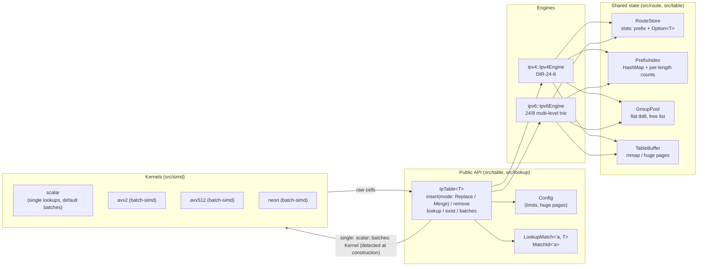
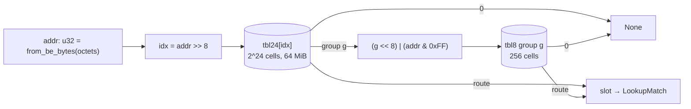
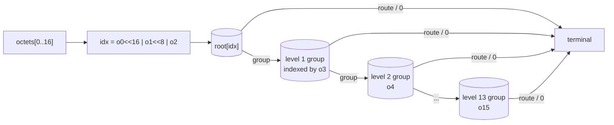
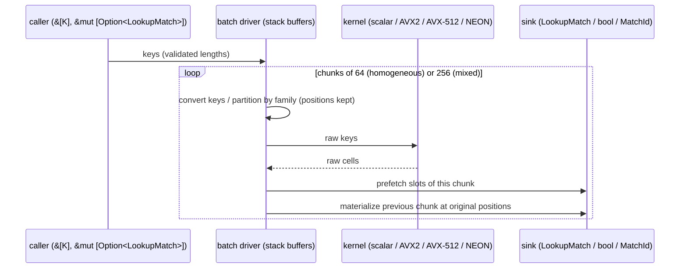
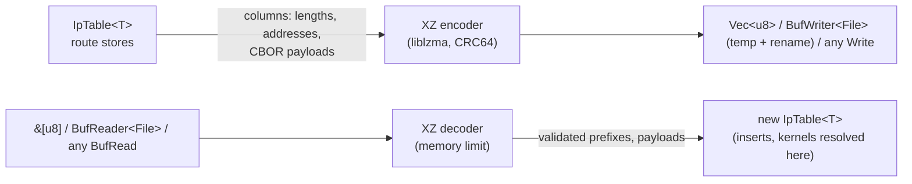

# Architecture

## Components

* `IpTable<T>` owns at most one engine per family, created on the first
  insertion of that family. Each engine owns its root (`tbl24`), its group
  pool, its route store and its prefix index.
* Kernels never see payloads: they read `u32` cells through a `Tables` view
  and return raw cells. The facade (or a batch sink) converts a cell into a
  borrowed `LookupMatch` with one slot read.
* Single lookups and `exist` call the scalar kernels directly. Batches go
  through `Kernel`, detected once per table: only `Scalar` without the
  `batch-simd` feature; with it, AVX-512 then AVX2 (x86-64) or NEON
  (AArch64) when the CPU has them. Its SIMD variants can only be built
  after runtime feature detection succeeded, which is what makes the
  `unsafe` calls of `#[target_feature]` kernels sound.

## Cell encoding

| Cell value | Meaning |
|---|---|
| `0` | no route covers the cell |
| `1 ..= 0x7FFF_FFFF` | terminal: route slot `value - 1` |
| `0x8000_0000 \| g` (`g < 2^23`) | secondary group `g` |

The group flag is the sign bit: AVX2 masked gathers use it directly as their
mask, AVX-512 obtains a `__mmask16` with one signed compare, NEON uses
`vcltzq_s32`. `(cell << 8) | byte` drops the flag and yields `g * 256 +
byte < 2^31`, a non-negative gather index. All cells covered by one route
hold the same slot, hence share the same payload.

## IPv4: DIR-24-8

At most **two dependent table accesses** whatever the prefix length; one
more read of the route slot to build the borrowed result (`exist` skips it).

## IPv6: 24/8 trie (FIB6 layout)

A route of length `L > 24` ends in level `k = ceil((L - 24) / 8)` and covers
`2^(24 + 8k - L)` cells of its group, so lengths that are not multiples of 8
are expanded inside a single group. A lookup costs **1 to 14 dependent
accesses** (a /48 route: 4, a /64: 6), unlike the IPv4 bound of two.

## Maintenance

Invariant: every cell holds the longest route covering all of its addresses.

* **Insert** `P/L`: inside the range of `P`, overwrite exactly the cells
  whose current winner is shorter than `L` (or empty), descending into
  nested groups. A missing group on the path is created and filled with the
  cell it replaces (inheritance of the best less specific route).
* **Remove** `P/L`: find the parent (longest remaining route strictly
  containing `P`, through the prefix index and its per-length counts), then
  rewrite every cell equal to `P`'s cell with the parent's cell.
* **Fold**: a group whose 256 cells become identical terminal cells is
  folded into its parent cell and pushed on the free list (bottom-up along
  the IPv6 path). Released groups are reused before the buffer grows.
* **Atomicity**: limits are checked first, then every fallible allocation
  (slot, index entry, groups) is reserved, and only then are cells written.
  A capacity or allocation error leaves the table unchanged.

## Batches

Kernels:

* IPv4 x86: phase 1 gathers the roots of a 64-128 key block (independent
  gathers), phase 2 runs masked gathers only for vectors with extended lanes.
* IPv6 x86: four vectors (64 lanes AVX-512, 32 lanes AVX2) are transposed
  into 32-bit words and walk the levels in lock step; at step `k` every
  active lane consumes octet `2 + k`, so the per-lane position is implicit
  in the step counter; finished lanes are masked off and keep their
  terminal cell.
* NEON: vector index math (`vshrq_n_u32`, `vorrq_u32`, `vminq_u32`,
  `vcltzq_s32`, `vld4q_u32` transposes) with one scalar load per active lane.
* Scalar: roots of a whole block first, then branch-free secondary steps
  (inactive lanes read the reserved, L1-resident group 0).

## Snapshots (feature `snapshot`)

* The source of truth is the route store of each family: one slot per
  inserted CIDR, masked or not, with its `Option<T>`. The lookup tables
  only hold winners and are never saved; loading reinserts the routes, so
  `tbl24`, groups, the prefix index and the batch kernel detection are rebuilt
  for the loading CPU.
* Saving walks the stores (slot order, or sorted with `EntryOrder::Sorted`)
  three times per family: lengths and addresses block by block, then
  payloads. Loading inserts the prefixes with no payload, then assigns the
  payloads in slot order: a fresh store allocates slots in insertion order,
  so no prefix list is kept.
* No adaptation of the table was needed: the stores already enumerate the
  exact logical state, at no extra memory cost.

## Memory

| Item | Cost |
|---|---|
| `tbl24` per family | 64 MiB reserved on the first insertion (mmap, lazily zeroed: resident pages grow with the address ranges touched) |
| secondary group | 1 KiB, buffer grows geometrically (copy on growth) |
| route slot | `size_of::<(Ipv4Net or Ipv6Net, Option<T>, bool)>()`; 16 B for `T = u32` (IPv4), 28 B (IPv6) |
| prefix index | `HashMap<prefix, u32>` |

Typical footprints are in [performance.md](performance.md).
